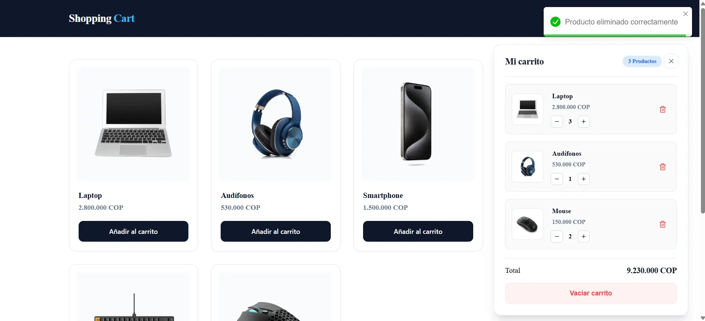

# 🛒 Laboratorio 01 — Shopping Cart

Primer proyecto de **React Labs**, una ruta de aprendizaje de React basada en la construcción progresiva de aplicaciones.

Shopping Cart es una interfaz de catálogo de productos con un carrito interactivo. El propósito del laboratorio fue practicar los fundamentos de React, incorporar TypeScript y organizar la lógica de estado en un hook reutilizable.

**[🚀 Ver demo en Netlify](https://01-shopping-cart.netlify.app/)** · **[⬅ Volver a React Labs](../../README.md)**



## 🎯 Objetivos de aprendizaje

- Construir componentes reutilizables y pasar información mediante **props**.
- Trabajar con **JSX**, eventos y renderizado condicional.
- Manejar estado local con **`useState`**.
- Generar listas dinámicas con **`map`** y `key`.
- Definir tipos e interfaces de datos con **TypeScript**.
- Extraer la lógica del carrito al hook personalizado **`useCart`**.
- Practicar actualizaciones inmutables de arreglos y cálculos derivados.
- Persistir datos en el navegador con **`localStorage`**.
- Construir y desplegar una aplicación Vite con Netlify.

## ✅ Funcionalidades implementadas

- Catálogo de seis productos cargados desde un archivo JSON local.
- Agregar productos al carrito, evitando entradas duplicadas.
- Abrir y cerrar el panel del carrito.
- Mostrar un estado vacío cuando no hay productos.
- Incrementar o disminuir cantidades, con mínimo de una unidad.
- Eliminar productos individualmente o vaciar el carrito.
- Calcular el total según el precio y la cantidad de cada producto.
- Mostrar un contador de productos distintos en el carrito.
- Conservar el carrito después de recargar la página mediante `localStorage`.
- Mostrar notificaciones de éxito al eliminar productos o vaciar el carrito.

> Este laboratorio usa datos locales: no incluye backend, pagos ni proceso de compra.

## 🧠 Conceptos aplicados

| Concepto                | Aplicación en el proyecto                                |
| ----------------------- | -------------------------------------------------------- |
| Componentes y props     | Separación de encabezado, tarjeta de producto y carrito  |
| `useState`              | Estado de apertura del carrito y productos seleccionados |
| Eventos                 | Botones para agregar, quitar y ajustar cantidades        |
| Renderizado de listas   | Productos y artículos del carrito mediante `map`         |
| Renderizado condicional | Panel abierto/cerrado y mensaje de carrito vacío         |
| TypeScript              | Tipos de productos, artículos y props                    |
| Hook personalizado      | `useCart` reúne operaciones y estado del carrito         |
| Inmutabilidad           | `map`, `filter` y spread para crear nuevos arreglos      |
| Estado derivado         | Total calculado con `reduce`                             |
| Persistencia            | Lectura inicial y guardado del carrito en `localStorage` |

## 🛠️ Tecnologías

- React 19
- TypeScript
- Vite
- CSS
- Lucide React — iconos
- React Toastify — notificaciones
- Netlify — despliegue

## 📁 Organización principal

```text
01-shopping-cart/
├── public/
│   ├── home.webp
│   └── products/
├── src/
│   ├── components/
│   ├── data/
│   │   └── products.json
│   ├── hooks/
│   │   └── useCart.ts
│   ├── type/
│   ├── App.tsx
│   └── index.css
├── package.json
└── README.md
```

## 💻 Ejecutar localmente

Necesitas Node.js y npm. Desde la raíz del repositorio:

```bash
cd projects/01-shopping-cart
npm install
npm run dev
```

Para comprobar la compilación de producción:

```bash
npm run build
npm run preview
```

## 🌐 Despliegue

**Demo:** https://01-shopping-cart.netlify.app/

Este laboratorio se publica como un sitio independiente de Netlify conectado a la carpeta `projects/01-shopping-cart` del repositorio. Así, futuros proyectos de React Labs podrán tener demos y configuraciones de despliegue propias.

## 📈 Continuidad de la ruta

Este proyecto es el punto de partida. Los próximos laboratorios introducirán conceptos nuevos de forma gradual, sin presentar como completadas características que todavía no se han desarrollado.

---

Desarrollado por **[José Carlos Oñate Rodríguez](https://www.josecarlosonate.com)** como parte de [React Labs](../../README.md).
